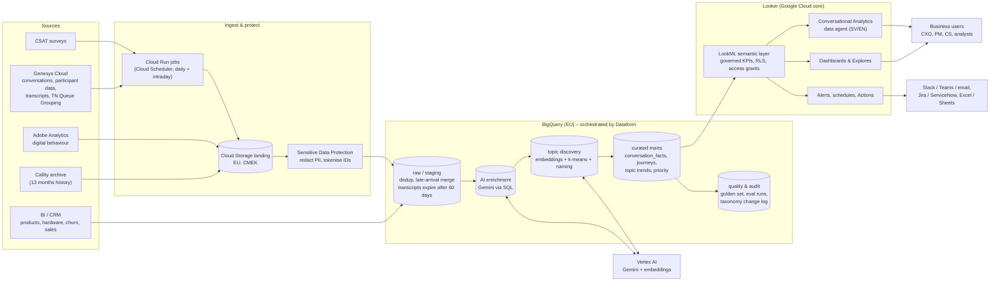

# Voice of the Customer on Google Cloud – Architecture Proposal

## 1. Summary

The platform turns every customer conversation (calls, chats, bot sessions) into structured, governed data, and then lets business
users explore it in Looker through dashboards, natural-language questions, alerts and scheduled reports.

The design rests on three choices:

1. **AI runs where the data lives.** Transcript analysis (topics, sentiment, root cause, triggers, competitor mentions, multi-intent)
   is done with Gemini called directly from BigQuery SQL (`AI.GENERATE_TABLE`, `ML.GENERATE_EMBEDDING`). No data leaves the EU
   BigQuery/Vertex AI boundary. No separate ML serving stack is needed, and every enrichment is stored with its model and prompt version.
2. **Insights are computed once, stored, then queried.** The LLM is never asked to "count" anything at question time. Every number
   a user sees comes from SQL over stored classifications through the Looker semantic layer (LookML). The same question therefore
   always returns the same answer, and every answer can be traced down to individual conversations (requirements 4.1.1, 10.3, 14.7, 14.8).
3. **Topics are discovered, not predefined.** Gemini writes a free-text issue label for every reason a customer raises. The labels
   are embedded and clustered, and the clusters are named by Gemini, which produces a versioned topic catalog. Because LookML models
   *topic* as data rather than as hard-coded fields, a newly discovered topic immediately gets the full KPI set (volume, customers,
   AHT, CSAT, repeat rate, churn, cost, trend, priority) without any code change.

## 2. Architecture diagram

## 3. Components

### 3.1 Capture and ingest (areas 1, 3)

| Source | Mechanism | Notes |
|---|---|---|
| Genesys Cloud – conversation metadata, participant data, AHT/ASA, transfers, queue | Cloud Run job calling the Analytics Conversation Details *jobs* API (bulk, daily) and the Notifications API (intraday) | `TN Queue Grouping` data table joined in staging to get business type, customer type and line of business |
| Genesys transcripts (human + virtual agent) | Speech & Text Analytics transcript API, or Genesys export to object storage | If only audio is available, transcribe with Speech-to-Text Chirp (Swedish supported) |
| Callity history (13 months) | One-off bulk export to Cloud Storage, same staging model | Source and coverage period are kept per row (`source_system`) so trends continue across the Callity → Genesys switch |
| Adobe Analytics | Data Feeds to Cloud Storage → BigQuery | Pre-contact digital behaviour (logins, failed flows, page visits) |
| Product, hardware, network, churn, sales | Existing BI warehouse → BigQuery (shared dataset or Analytics Hub listing) | Avoid duplicating customer master data |

Freshness requirement (3.1.1, 24h): a daily run after the Genesys day closes, with an intraday run for early-warning topics.
Every table carries `ingested_at`, and a `data_freshness` table records last load, latest event, duplicates and late arrivals. Looker
shows these on the start page (7.14.1).

Late and duplicate data (3.2.1): staging deduplicates on `conversation_id`, keeping the latest version. Marts are rebuilt
incrementally over a rolling look-back window (e.g. 7 days) with `MERGE`, so late rows correct history automatically. Corrections
are visible as `late_arriving_records`.

### 3.2 Privacy layer (area 6) – applied *before* anything is analysed

- **Sensitive Data Protection** de-identifies transcripts at landing: names, phone numbers, emails, addresses and the Swedish
  personal identity number (built-in infoType), replaced with tokens such as `[CUSTOMER_NAME]`.
- **Tokenisation** of customer identifiers (deterministic encryption) produces a stable pseudonymous `customer_key`. That key powers
  unique-customer counts and journey stitching (2.1.1) without exposing identity. The re-identification key is held in Cloud KMS
  and only a very small admin role can use it (6.4.1).
- **Exclusion rules** (6.3.1) live in a compliance-owned table: protected identity, objection to processing, and sensitive queues
  such as *Reklamation*. Excluded contacts keep their operational metrics but their text is never sent to a model. They appear as
  "Excluded (privacy rule)" so coverage stays transparent.
- **Retention**: raw transcripts are stored in a table with 60-day partition expiration. AI-derived fields (categorisation and
  summaries) are kept for 36 months, as required by 4.1.1.
- **Platform controls**: EU-only location, CMEK, VPC Service Controls around BigQuery/Vertex AI/Storage, Cloud Audit Logs.

### 3.3 AI enrichment in BigQuery (areas 4, 5, 11)

**Step 1 – per-conversation extraction** (`AI.GENERATE_TABLE`, Gemini Flash-class model, temperature 0). This produces one
structured row per conversation:

`summary, primary_issue, secondary_issues[] (multi-intent), journey_step, product_area, hardware_model, network_operator,
customer_sentiment, sentiment_score, trigger_event, root_cause, resolution, resolved_in_contact, failure_demand,
self_service_attempted, repeat_contact_mentioned, churn_risk, termination_requested, competitor_name, competitor_offer,
competitor_price_sek, evidence_quote, confidence`, plus `model_version`, `prompt_version` and `enriched_at`.

- Swedish and English transcripts are handled by the same prompt. Output fields are normalised to English; the evidence quote stays verbatim.
- The run is incremental and idempotent: only new conversations are sent, and failed rows are retried on the next run.
- `confidence` lets analysts filter out low-quality classifications for deep dives (4.1.1).

**Step 2 – topic discovery** (weekly full run, daily incremental):

1. Every primary and secondary issue label is embedded with a multilingual embedding model (`ML.GENERATE_EMBEDDING`).
2. BigQuery ML k-means clusters the embeddings (cosine distance).
3. Gemini names each cluster: a specific topic name (level 2), a theme (level 1, preferring the governed list but allowed to
   propose new ones), and a description.
4. Conversations are mapped to topics through a bridge table, so one conversation can count in several topics.
5. The new taxonomy version and its changes are written to `taxonomy_change_log` (who, what, when) – requirement 6.5.1.

In production, daily runs assign new labels to the *nearest existing topic centroid* (`VECTOR_SEARCH`). That keeps topic IDs stable
week to week. Labels with no close centroid become **new topic candidates**. This is how "something big and unexpected on Wednesday"
shows up the next morning, without waiting for anyone to update a category list.

**Step 3 – decision support**: per topic, Gemini receives *aggregated* statistics only (volume, AHT, CSAT, repeat, churn, top root
causes and triggers). It returns a standardised problem statement, a recommended action, a suggested owner and an expected impact
(11.2, 11.3). It also writes one "Insight of the day" for the start page (7.2.1).

### 3.4 Curated marts (areas 4, 5, 9)

| Table | Grain | Purpose |
|---|---|---|
| `conversation_facts` | conversation | Genesys KPIs + AI insight + primary topic + journey flags (repeat contact within 7 days, previous channel, contact sequence) + lifetime band |
| `conversation_topics` | conversation × topic | Multi-intent bridge (primary / secondary) |
| `topic_catalog` | topic | Versioned discovered taxonomy |
| `topic_recommendations` | topic | AI problem statement, action, owner |
| `data_freshness` | source | Freshness, duplicates, late arrivals |
| `eval_*` | run / metric | Model quality against a labelled golden set |

Production adds a `customer_events` timeline (digital events, outages, outbound campaigns, orders) joined to contacts within a
configurable 1–30 day window. That powers the "what happened before the contact" analysis (5.2.1, 8.10.1) and baseline comparisons
of customers who contacted vs. those who did not.

### 3.5 Looker – semantic layer and experience (areas 7, 8, 9, 10, 12)

- **LookML** defines every KPI once (contacts vs. unique customers, AHT, FCR proxy, repeat rate, churn rate, failure demand, cost
  proxy, coverage), each with a plain-language description. These descriptions are also what Conversational Analytics reads.
  The glossary is therefore the model itself (7.16.1, 10.4.1).
- **Row-level security**: `access_filter` on business type driven by user attributes. A B2B CS manager only sees B2B data (6.1.1).
  Derived tables apply the same attribute inside their SQL.
- **Field-level security**: `access_grant` on transcript text and AI transcript search. Default roles never see raw text (6.4.1).
- **Dashboards**: start page with insight of the day, KPIs, emerging issues, priority ranking and trends, plus a topic deep dive
  with an evidence table. Drill-downs open the individual conversations.
- **Conversational Analytics** (Gemini in Looker): natural-language questions in Swedish or English, follow-up questions,
  and the generated query and filters shown for every answer (7.8, 7.12, 10.1). A configured *data agent* holds the business
  glossary and rules, for example "always show contacts and unique customers" or "never claim causality for churn".
- **Self-service KPIs**: custom fields and table calculations (with Formula Assistant) let users build their own KPIs without
  changing the governed baseline (9.2.1). Analysts promote proven ones into LookML through Git pull requests.
- **Alerts and schedules**: threshold alerts on the emerging-issues tile, and weekly/monthly scheduled reports to email,
  Slack or Teams (12.2.1). Exports go to Excel/CSV/Google Sheets with filters stated and no identity fields (12.1.1).
- **Actions**: Looker Actions/webhooks create Jira or ServiceNow tickets from a prioritised problem, which links insight to owner (11.3, area 12).
- **Adoption** (15.2.1): Looker System Activity shows active users, content usage and query volumes by group.
- **Personalisation**: user attributes set the default value chain and business area, plus personal folders, saved views and
  boards (8.2–8.4, 9.3).

### 3.6 Quality, evaluation and operations (area 14)

- **Golden set**: 300–500 human-labelled conversations, versioned in BigQuery. Every prompt or model change re-runs the evaluation
  (topic purity, field accuracy, competitor precision/recall, multi-intent recall). Results go to `eval_runs` and are compared across
  versions in Looker (14.5.2). The demo includes this step against the generator's ground truth.
- **Numeric QA** (14.7.1): a fixed set of questions with known answers ("calls last 14 days, Fixed, by day") runs against both the
  Explore and the Conversational Analytics agent after each release.
- **Feedback** (14.1.1): thumbs up/down in Conversational Analytics, plus a "flag this insight" Looker Action that writes to a
  feedback table the VoC team triages.
- **Orchestration and CI/CD**: Dataform (SQLX in Git, assertions as data-quality tests) for transformations, Cloud Scheduler or
  Composer for the daily DAG, and Looker Git integration with dev/prod branches for LookML (6.5.1: controlled path to production).
- **Monitoring**: Cloud Monitoring on job failures, enrichment backlog, Vertex AI quota errors and freshness SLA. Looker alerts
  when `data_freshness` breaches 24 hours (7.15.1).
- **Cost control**: Flash-class model for extraction, incremental enrichment only, embeddings on distinct labels (not on every
  conversation), and Looker query caching tied to the daily load (datagroup). The ad-hoc AI transcript search always samples and
  is limited to analyst roles.

## 4. How the architecture answers the eight follow-up questions

| Question | Where it is solved | How it is surfaced in Looker |
|---|---|---|
| 1. Transcript analysis without predefined categories | Gemini extraction of free-text issues, sentiment, root cause; embedding clustering | Topic, theme, sentiment, root cause as dimensions in every Explore |
| 2. Open-ended natural-language questions + follow-ups | Governed LookML model + agent instructions | Conversational Analytics data agent; "Ask the Transcripts" for questions no field covers yet |
| 3. Dynamic KPI creation | New topics become rows, not code; promotion path for ad-hoc statements into the extraction schema | Every new topic instantly has the full KPI set; custom fields; Looker API for auto-alerts |
| 4. Combining structured and unstructured data | `conversation_facts` joins Genesys KPIs, churn and segments to AI fields at conversation grain | Any AI field × any KPI in one Explore (e.g. AHT and churn by root cause and lifetime) |
| 5. Emerging issues | First-seen + 7-day vs 4-week baseline + z-score spikes; new topic candidates from clustering | Emerging issues tile, alerts to Slack/Teams/email, insight of the day |
| 6. Prioritisation | Transparent score from volume, cost, experience, repeat, churn; AI recommendation + owner | Priority Explore with adjustable weights and a "Why this rank?" column |
| 7. Explainability | Evidence quote, confidence, model/prompt version stored per conversation | Drill from any number to conversations and transcript (role-restricted); query shown for CA answers |
| 8. End-to-end VoC | Transcript → enrichment → topic → KPI → priority → action | Start page → deep dive → evidence → recommendation → alert / Jira |

## 5. Requirement coverage (MVP areas from the requirements document)

| Area | Covered by |
|---|---|
| 1 Data collection & coverage | Genesys + Callity ingestion; `classification_status` and transcript coverage measure; per-channel coverage tiles |
| 2 Data architecture & integration | Pseudonymous `customer_key`, conversation/session IDs, queue grouping; unmatched product/network mappings shown as "(not mentioned)" |
| 3 Pipeline & ingestion | Daily + intraday jobs; dedup; late-arrival merge; freshness table |
| 4 Insight extraction | Open-ended extraction, multi-intent bridge, confidence, contacts vs. unique customers, drivers/root causes |
| 5 Journey stitching | Repeat-contact and channel-path flags on the customer key; lifetime band; region; hardware and network context |
| 6 Governance & security | DLP, tokenisation, exclusions, retention, RLS / access grants, audit logs, taxonomy change log |
| 7 UX | Start page with insight of the day, SV/EN conversational interface, freshness and coverage, glossary in field descriptions |
| 8 Personalisation | User attributes for default scope, boards, saved views, personal dashboards |
| 9 Reporting | Governed KPI baseline in LookML; custom KPIs; shared dashboards |
| 10 Explainable insights | Evidence quotes, drill to source, query transparency, exportable underlying data for analysts |
| 11 Decision support | Failure vs. value demand, priority score, problem statements, owners |
| 12 Action & follow-up | Exports, schedules, alerts, Actions to ticketing |
| 14 Quality | Golden set, eval runs, numeric QA, feedback loop |
| 15 Adoption | System Activity usage dashboards, onboarding content linked from dashboards |

## 6. Delivery roadmap

| Phase | Scope | Outcome |
|---|---|---|
| 0 – Foundation (3–4 weeks) | Landing zone, VPC-SC, DLP, Genesys ingest, BigQuery staging, Looker instance + Git | Trusted Genesys metrics in Looker |
| 1 – MVP insight (6–8 weeks) | Gemini extraction, topic discovery, marts, start page, deep dive, CA agent, golden set | Questions 1–8 answered on production data |
| 2 – Journeys & outcomes | Adobe digital events, BI product/churn/sales, pre-contact window analysis, value-chain views | Requirements 5.x and 11.x fully on real joins |
| 3 – Act & scale | Alerts and Jira actions, scheduled reports, feedback loop, embedding in the intranet, publishing the agent to Gemini Enterprise | Closed loop from insight to owner to measured impact |

## 7. Design decisions and alternatives

- **BigQuery + Gemini vs. Conversational Insights (CCAI Insights).** Conversational Insights gives managed topic modelling,
  sentiment and QA scorecards and can export to BigQuery. It is a valid accelerator if audio transcription and agent QA are also in
  scope. Gemini in BigQuery is preferred for the analytics core because the requirements need custom fields (triggers, root
  causes, competitor offers, failure demand) and multi-intent, all versioned and joined at conversation grain with operational data.
  The two can coexist: Insights for QA and transcription, BigQuery for VoC analytics.
- **Looker vs. Looker Studio.** Row-level security, access grants, a governed semantic layer, Conversational Analytics on top of
  LookML, alerts, Actions and Git-based change control are Looker (core) capabilities that the governance requirements depend on.
- **Insight computed in batch vs. LLM at query time.** Batch makes numbers reproducible and cheap. Query-time AI (`AI.IF`) is
  kept for exploratory questions, is clearly labelled as sampled and estimated, and is limited to analyst roles.

## 8. Open questions for the customer

1. Is a Genesys transcript available for all voice contacts (Speech & Text Analytics licence), or do we need to transcribe audio?
2. Which customer identifier is available at ingest for linking Genesys, Adobe and BI (BankID-verified SSN, customer number, MSISDN)?
3. Can evidence quotes (redacted, one sentence) be retained beyond the 60-day transcript window, or must they expire with the transcript?
4. Target data residency: is the EU multi-region acceptable, or must processing be pinned to a Nordic region? (Confirm Gemini model availability per region.)
5. Daily contact volume and history to backfill (36 months of categorisation): this sizes the one-off enrichment cost and quota.
